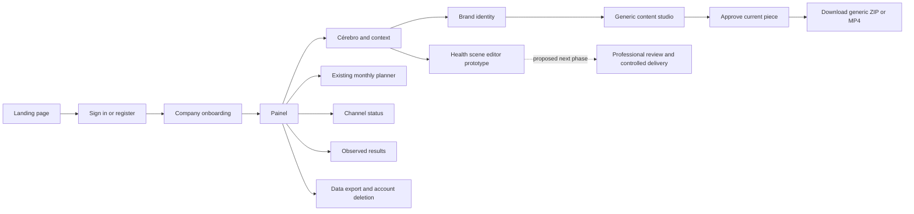

# Nukkia app map and missing screens

Prepared for Nicola and Amgad on 2 October 2026. This maps the current local app to its existing routes, server handlers and Supabase storage. The next step is to connect and qualify these screens against the intended database, then build the missing Health production workflows. Keep the product name **Nukkia** and call the brand context **Cérebro** or **cópia digital da marca**.

There are **15 page URLs, 13 API routes and 9 SQL migration files** in this snapshot. Tabs, editors and query-string views are listed separately below; they are not extra page URLs. A screen being present does not establish that its cloud persistence or production workflow has passed end-to-end tests.

The local working tree contains changes beyond commit `5f1a1dab06e003b47614d0597bd8279db2b391c3` on `codex/nukkia-onboarding`. Amgad needs the handoff snapshot, not only that commit. See the [database handoff](2026-10-02-backend-handoff-amgad.md) for contracts, activation order and acceptance checks.

## Latest increment — Atlantic homepage and content calendar

Candidate `c50965d20fde50c3b7a52575b1567a073554296eb6a4e218c3ce63409be02b1c`: [exact source binding and verification](operations/2026-10-05-atlantic-evidence/homepage-calendar-verification.md). `/` now uses the approved Atlantic proposal; `/proposta` redirects there. Explicit Calendário navigation opens a month/day calendar with version-bound bubbles, time, timezone and channel. Generic “Três abordagens” is superseded by a **six-approach creation phase** under Briefing. This supersedes those labels and layouts in the historical rows below, without upgrading their qualification claims. Final checks: 601 tests pass, typecheck/build pass, scoped lint clean. Desktop populated and narrow empty calendar states verified; authenticated persistence and populated mobile state remain unqualified in this increment.

## Current accepted-journey candidate — implementation versus qualification

Candidate **`baabfc16dce1e53aa164bbf9870a4cca12e18f21746e781281fbf68d87cfe6c5`**, branch `codex/nukkia-onboarding`, unchanged base `5f1a1dab06e003b47614d0597bd8279db2b391c3`. [Source manifest](operations/2026-10-05-healthcare-followup-evidence/source-manifest.json): preserved implementation plus nine-file healthcare follow-up delta. [Execution and qualification record](operations/2026-10-05-complete-journey.md).

All 18 references were visually inspected in the preceding audit; those observations are reused. Every row remains **partial qualification**, with accepted local elements implemented and actual sampled observations recorded below. The [follow-up record](operations/2026-10-05-healthcare-followup-evidence/browser-checks.md) distinguishes incremental browser observations from exact final-candidate proof. Final automated checks: **580 tests**, typecheck/build pass, this-pass lint clean. Full lint separately retains 99 errors/9 warnings. No authenticated acceptance or exhaustive screenshot coverage is claimed.

| Exact reference filename / function | Route/component | Implemented accepted elements | Intentional adaptation | Observable acceptance check, still awaiting current browser evidence  Actual verification / remaining gap |
| --- | --- | --- | --- | ---  --- |
| `Captura de tela 2026-10-01 170009.png` — Welcome | /demo; /boas-vindas · DemoWorkspace/AccountOnboarding | Focused logo, explanation, continue; blank-account welcome now follows theme; demo has no fabricated account fields. | Official symbol replaces mascot. | Continue once; reload and back retain the saved step.  Partial: fresh healthcare onboarding reached dashboard; reload/back welcome matrix pending. |
| `Captura de tela 2026-10-01 170026.png` — Welcome, alternate framing | Same onboarding | Same welcome implementation, independently inspected reference; responsive CSS present. | No duplicate wizard for an alternate crop. | At 320/390 px both themes, continue and progress remain visible without horizontal overflow.  Partial: same welcome implemented; 320/390 both-theme welcome proof pending. |
| `Captura de tela 2026-10-01 180426.png` — Website/manual setup | BrandOnboarding; WorkspaceContextEditor | Optional source and manual context path; edits return to the originating content view. | No automatic extraction promise. | Skip website, enter synthetic context, return to brief, reload without losing inputs.  Partial: skipped site and completed manual context; identity return preserved brief; context-edit return not rechecked. |
| `Captura de tela 2026-10-01 180507.png` — Language selection | BrandOnboarding; DemoWorkspace | Explicit Brazilian Portuguese scope and existing back/progress controls. | Fixed PT-BR replaces unsupported language grid. | Language scope is visible; no control implies an unimplemented language.  Partial: PT-BR scope observed; no language-switch promise. |
| `Captura de tela 2026-10-01 180532.png` — Business name/industry | Setup; /diagnostico | Brand/segment and context editing retain existing facts; validated origin returns to content. | Service vocabulary and confirmed facts remain distinct from hypotheses. | Edit audience, return to brief; brand name and human creative text remain unchanged.  Partial: synthetic name/segment/audience retained through saved-plan reload; edit-existing-context matrix pending. |
| `Captura de tela 2026-10-01 180617.png` — Identity settings | /marca; demo identidade | Actual applied-piece preview, editable colors/logo/photo/style, identity draft/apply state, story and references. | Nukkia shell retains official identity; output uses customer identity. | Save/apply separately; return to brief/options/editor; reload preserves intended identity and text.  Partial: identity save/return observed. 1024/320 clipping fixed and bounds checked; logo/photo upload blocked. |
| `Captura de tela 2026-10-01 180644.png` — Product master/detail | WorkspaceServices · Cérebro | Service list/detail, conditions/validity/archive, local image/source/permission, explicit service-to-brief snapshot. | Services replace products; local catalog remains browser-local. | Create synthetic service with image; apply once; edit catalog afterward without silently changing historical brief.  Partial: synthetic service created in prior QA tab. Applying service is blocked by native confirmation; image upload also blocked. |
| `Captura de tela 2026-10-01 180732.png` — Home creation entry | /painel; demo painel · MarketingViews | Creation choices precede setup; Image/Carousel open focused brief, resume opens current work; live draft preview. | No invented credits, achievements or unsupported email format. | Each shortcut reaches its named view; starting a new brief preserves existing creative until confirmation.  Partial: carousel shortcut opens brief; complete shortcut/replacement matrix pending. |
| `Captura de tela 2026-10-01 180755.png` — Saved home gallery | Painel; ContentLibrary | Actual saved snapshots, title/version/format/status and exact-version navigation. | Saved user work replaces seeded examples. | A later draft edit does not alter saved thumbnails; selecting a card opens the shown version.  Partial: library snapshots retain v1 and v2; home card exact-version click not rechecked. |
| `Captura de tela 2026-10-01 180823.png` — Image methods | ContentStudio/ContentRecommendation | Three illustrative options, explicit prepare/replacement; selected image/carousel intent honored. | Explicar/Confiar/Convidar replace unsupported clone/translate methods. | Compare all three, choose each on separate synthetic items, cancel replacement without data loss.  Partial: three options displayed and draft prepared; all alternatives and replacement cancel remain pending. |
| `Captura de tela 2026-10-01 180851.png` — Focused brief | Conteúdo vista=briefing · PieceBrief | Idea, goal, audience, format, advanced constraints/materials; return to context/identity; prepare guard. | Fixed 1080×1350; manual review constraints; no arbitrary quantity/credit controls. | Empty idea blocks prepare; valid input influences options; brand facts remain intact after reload.  Partial: empty idea disabled prepare, valid idea/goal used, identity return preserved inputs. |
| `Captura de tela 2026-10-01 180910.png` — Video methods | HealthStudio | Supported illustrative templates, idea/script, ratio/duration and actual readiness explanation. | Text-frame prototype; no actor cloning/render promise. | Each template opens its own editable scenes; returning/back preserves work and reports unavailable production.  Partial: Roteiro em cenas chosen and prepared; complete catalog template traversal pending. |
| `Captura de tela 2026-10-01 180930.png` — Visual source chooser | MaterialInput; PieceBrief; InspirationBoard | Local PNG/JPG/WebP, inspectable preview/source/permission, reusable service/reference/history images; explicit use/cancel/remove. | Self-declared rights are not legal clearance; selection alone never grants production authority. | Invalid upload retains previous image; cancel changes nothing; late upload cannot replace a newer selection; reload retains chosen material.  Partial: source UI implemented; actual local upload blocked by connector permission. Regression tests do not qualify screenshot coverage. |
| `Captura de tela 2026-10-01 180952.png` — Actor/script/timing | HealthStudio; HealthReadiness | Idea and optional material before options, editable scenes/script/timing/ratio; missing reviewer/identity visible. | Owned-professional requirements replace stock-actor assumptions. | Edit script and timing, change ratio, save/reopen; no action falsely claims a produced video or professional release.  Partial: idea, 15s/1:1, scenes/save/reload observed; other ratios/durations and professional-account states pending. |
| `Captura de tela 2026-10-01 181015.png` — Preview editor | FirstPostWorkspace; HealthStudio; ContentLibrary | Desktop preview beside fields, page/scene rail, explicit approval/export; full saved-version inspection; shared new-item composition transition. | Only supported edits; generic approval is separate from clinical release. | Edit each page, save v1/v2, inspect/reopen either, create independent item through either prepare action; old versions stay unchanged.  Partial: page edits/v1/v2/inspection/duplicate/archive/plan/reload observed. Resume confirm blocked. Approval works; download delivery timed out. |
| `Captura de tela 2026-10-01 181134.png` — Scene sources/idea | HealthStudio; MaterialInput | Per-scene optional reference, idea/script, timing/reorder/undo/redo; shared pixel pool preserves bounded history. | No generated first/last frame or rendered audio promise. | Attach synthetic image, reorder/edit/undo/redo and reload; same image remains attached to intended scene without multiplying history bytes.  Partial: scene reorder/undo/redo/merge/split/add/delete/save/reload observed; material attachment blocked. |
| `Captura de tela 2026-10-01 181141.png` — Expanded scene shell | HealthStudio; WorkspaceShell | Shared navigation, stable scene selection during edits, persisted Health draft, active section title. | No duplicate Playground destination. | Every content tab and sidebar return preserves selected work; keyboard can reach scene actions.  Partial: selected scene now follows reorder; menu Escape/focus and keyboard Library/trail observed; full navigation matrix pending. |
| `Captura de tela 2026-10-01 181155.png` — Scene alternate framing | HealthStudio responsive views | Responsive reflow implemented; reference is smaller framing, not mobile qualification. | Shared Nukkia mobile shell and theme tokens. | At 1360/1024/390/320 in both themes, all scene fields/actions remain reachable with visible focus.  Partial: Health desktop both themes, 390 light/320 dark sampled; 1024 Health and complementary width/theme states remain pending. |

Beyond the screenshots, the monthly agenda now has selected-item detail, exact version, date and channel; library inspection includes saved body/pages and materials. Success requires save → library → reopen/edit/v2 → duplicate → archive/restore → plan → reload, verifying that v1, independent copy, date and channel stay correct. This is planned intent, not publishing.

**Remaining priority:** (1) current-candidate screen/button/keyboard and 1360/1024/390/320 both-theme walkthrough, fixing observed defects; (2) authenticated two-session recovery, conflict and two-workspace denial checks in authorized disposable spaces; (3) separately authorized Health production identity/rights/jobs/review/delivery and channel publishing, which remain missing production screens/workflows. Browser-local service catalogs are not cross-device functionality. See the execution record for exact checks and authorization. The earlier matrices below are historical and must not override this qualification status.

## Preceding local refinement — section titles and Minha trilha

The [interactive-trail update](operations/2026-10-05-trail-update.md) supersedes source identity with candidate `46f8df957a5621ca4b803195672f5bd1730f23105033ae4f850c6874e62c12e4`. The shared top title follows the sidebar; duplicate home/trail headings and the demo sidebar restart action are removed. Minha trilha now has a connected path of five circular steps, each opening two explanatory bullets and its existing actions. Progress remains derived from saved work. Native navigation, Enter/Tab expansion, desktop/light and narrow/dark samples are recorded; 553 tests/typecheck/build pass. Previous 18-reference and saved-journey evidence below retains its exact historical candidate and qualification limits.

## Current screenshot-to-screen implementation audit — 5 October 2026

All **18 actual images** were opened and inspected in this continuation. Reference suffixes below resolve to `Captura de tela 2026-10-01 <suffix>.png` in `/Users/nicolacaprirolo/Downloads/Screenshots`; [reference hashes](operations/2026-10-05-screen-audit-evidence/references.json) identify the exact inputs. Similar framing is recorded separately; it is not treated as proof of a responsive implementation.

Exact candidate for this historical audit: branch `codex/nukkia-onboarding`, base `5f1a1dab06e003b47614d0597bd8279db2b391c3`, **70 changed/untracked source/test files**, aggregate SHA-256 **`cc2a64d6e327af554216289aefae6c9ee2d52481774b131de4e5f7624d824aa1`**. [Source manifest](operations/2026-10-05-screen-audit-evidence/source-manifest.json), [delta from preceding candidate](operations/2026-10-05-screen-audit-evidence/candidate-delta.json), [audit result and success definitions](operations/2026-10-05-screenshot-screen-audit.md). Existing work is included, not attributed wholesale to this milestone.

Evidence keys for that historical candidate: **B** = [preceding native browser observations](operations/2026-10-05-screen-audit-evidence/browser-checks.md) and PNGs linked there through the audit record; **T** = [historical 551-test log](operations/2026-10-05-screen-audit-evidence/tests.log); **P** = [preceding saved journey](operations/2026-10-05-saved-content-journey.md), bound to its own candidate. Source presence/build success alone is **implemented**, not browser- or authenticated-qualified. No row below is authenticated-qualified.

| Reference → observed content | Nukkia route/view | Required layout and interactions / success | Implemented elements | Deliberate adaptation | Remaining gap / qualification boundary | Actual evidence |
| --- | --- | --- | --- | --- | --- | --- |
| `170009` → sparse mascot welcome, speech bubble, next action at lower right | `/demo` entry; `/boas-vindas` | Focused welcome; understandable setup; one next step | Official logo, short welcome, continue, saved step recovery | Nukkia symbol and practical explanation replace mascot | Real authenticated interruption/resume pending | P manual onboarding; T onboarding/recovery; no new welcome PNG |
| `170026` → same welcome with tighter framing | Same entry | Same data/actions at narrow width; no duplicated wizard | Existing responsive setup and progress | No separate mascot screen or artificial extra step | Full entry width/theme matrix pending | P journey; T; image inspected independently |
| `180426` → website input and no-website alternative | Demo setup; Cérebro context editor | Optional URL, explicit permission, manual path, preserve back edits | Manual/source inputs, permission flags, recovery/context return | Public URL is context, not blanket permission or automatic research | Hosted extraction requires authorized tenant/provider setup | P synthetic manual path; T context/consent/recovery |
| `180507` → searchable language/flag grid, back/progress, English selected | Demo/onboarding scope | Clear actual language and saved-step progress | Brazilian Portuguese interface; existing saved progress/back controls | Fixed first-market Portuguese; no fictitious multilingual grid | Additional languages not offered; auth resume unqualified | Source `demo`, shell; T navigation; B current PT-BR labels |
| `180532` → business name and industry dropdown | Setup; `/diagnostico` / Cérebro | Editable brand/segment, preserve offer/audience/context | Named brand, segment, context editors with return path | Clinic/service vocabulary; essential context retained | Auth persistence/tenant switch pending | P synthetic brand/context; T context edits |
| `180617` → editable colors/logo/mission/guidelines | `/marca`; demo Identidade | Preview beside controls; distinguish draft/applied; deliberate save | **New preview-first workbench**, actual creative SVG, identity state, style/color/logo/photo controls; existing story/book and Inspirations | Story/context stays in its existing editor; references carry self-declared permission, not clearance | Live expired-logo refresh and authenticated story not browser-qualified | B identity 1360 dark + 320 both themes; T identity/reference invalidation |
| `180644` → product master list and selected image/title/description detail | Cérebro → Serviços e ofertas | List/detail create/edit/archive; select confirmed offer and provenance | Existing catalog, status, validity/conditions/source; explicit apply-to-brief | Services instead of retail products; no scraping/asset-rights promise | Catalog is browser-local; no cloud migration; authorized media ingestion deferred | P confirmed service → brief; T catalog/application/stale-write callbacks |
| `180732` → grouped sidebar, setup shortcuts, creation feature, format cards | `/painel`; demo Meu painel | Find setup and supported creation; direct resume | Grouped navigation, real progress/notifications, shortcuts; **working Carousel entry** beside Image/Video | No mascot/credit promises; existing earned progress only; no unsupported Email action | Home full state matrix remains sampled | B home 1360 light and Carousel→Explicar; T non-destructive intent callback |
| `180755` → lower home gallery and same format cards | Painel → Versões guardadas; Biblioteca | Actual thumbnail/title/time/version; open correct saved item | **Snapshot-derived thumbnails**; recent versions link exact ID/version | Owner's saved data replaces seeded gallery; empty state remains useful | Fresh-session cloud recovery pending | B home saved v1 copy/v2; T saved-vs-live preview regression; P exact resume |
| `180823` → image-method card grid | Conteúdo → Três abordagens; home Image/Carousel | Compare supported paths and purpose; preserve current draft | **Three illustrative previews**, radio selection, brief facts/hypotheses and explicit prepare action | Explicar/Confiar/Convidar replace clone/swipe/translate methods; no fake methods | Paid/provider options not activated | B 320 light options; T preparation/navigation; P chosen option/edit |
| `180851` → instruction box, advanced settings, ratios and quantity | Generic brief/editor; Health brief | Editable goal/service/idea; applicable output settings; no hidden generation | Generic service/context brief and editable message; Health script/ratio/duration controls | Generic output uses existing fixed artwork format; Health has supported ratios; no meaningless generic quantity/credit controls | Provider render settings remain unavailable; generic free ratio is outside current output contract | P service→options→editor; T creative/Health configuration; Health source review |
| `180910` → video-method choices | Conteúdo → Estúdio de saúde | Supported method/format choice and honest availability | Existing selectable Health video templates; three editable fictional scripts | Generic MP4 route remains separate; no offered clone/lipsync/unknown actor mode | Full production workflow requires separate authority/providers | T Health UI/domain; existing Health handoff; no new live provider proof |
| `180930` → selected large source, reusable thumbnail strip, continue | Conteúdo → Reutilizar conteúdo da biblioteca; Identidade → Inspirações | Select inspectable version/source; deliberate replacement; cancellation preserves work | **Reusable saved-source card strip**, version selector, provenance, confirm/cancel; existing link/reference board | Reuses existing snapshots; no duplicate asset store; selection does not clear rights | Uploaded reference ingestion and Health cleared-material selection remain deferred | B exact v1/v2 reuse/cancel, 1360 dark and 320 light; T cancellation/context preservation |
| `180952` → actor/scene, script, duration and ratio | Health briefing; Prontidão e revisão | Editable script/timing/ratio; missing identity/reviewer visible | Existing structured brief, ratio/duration, readiness with explicit missing prerequisites | Owned professional/twin requirements replace stock actor/testimonial assumption | Real identity, rights, twin and professional review require separate setup | T Health/readiness; source inspected; no authenticated/production proof |
| `181015` → central image, right thumbnail rail, editing toolbar, share/download | Minha peça; Health scene editor; Biblioteca | Correct selected page/scene editing, preserve human text, separate approval/export | Existing central generic preview/page controls and Health scene rail; saved versions; **library format/status filters** follow inspected snapshot | Tools limited to actual edits; generic creative approval never becomes clinical release; no unsupported erase/upscale/share | Complete Health rendered media/export not available | B restored v2 editor/reload; P save→v1/v2/copy/archive; T selection/approval/version filters |
| `181134` → three scene/source slots with optional first/last frames, idea, ratio/duration, tight crop | Health brief/options/editor | Same scene document drives selection/timing/reorder; optional input honesty | Existing script options, selected scene fields, total timing, accessible reorder and undo/redo | Text-frame prototype; no fake uploaded/generated first/last frame or audio | Cleared source ingestion and full media playback pending | T Health scene/history/duration invariants; source reviewed; no new Health PNG |
| `181141` → same scene setup with expanded sidebar/playground navigation | Same Health views in shared shell | Navigation/back preserves existing draft; no duplicate workflows | Shared seven destinations, content tabs and persisted Health draft | No extra Playground destination; unsupported methods not promoted | Auth recovery/production states unqualified | T navigation/persistence; B shared shell; no claim of visual Health parity |
| `181155` → same scene layout in smaller framing | Same Health responsive views | Reflow while preserving scene controls and selected data | Existing responsive scene layout and shared narrow shell | Smaller reference crop is not mobile evidence; actual Nukkia samples separately measured | Health-specific full width/theme matrix remains pending | Image inspected; T Health; B generic shared shell only |

Other accepted surfaces have no supplied interior reference: monthly planning has exact-version dated intentions, now rechecked after reload; Canais and Resultados retain honest connection/observed-data states; Conta now uses the shared canvas/cards with a separate danger area. Recovery/export/deletion/logo contracts retain prior regressions. Account is source/build-qualified only, not browser-qualified behind authentication. Landing/legal/admin are preserved and not newly visually certified. Operational Health review, Inbox-like review queues, measured analytics and publishing are not inferred from navigation labels.

Current checks: **551 passed, 0 failed, 0 skipped**; typecheck/build pass; scoped lint **0 errors / 2 existing warnings**. Repository lint separately remains **99 errors / 9 warnings**, unchanged integration/legacy backlog. Five intentional regression failures and five temporary harness failures were resolved; see audit record. Current candidate supersedes the implementation identity below, but does not retroactively rebind earlier screenshots.

## Preceding qualification — saved-content milestone, 5 October 2026

Exact candidate: base `5f1a1dab06e003b47614d0597bd8279db2b391c3` plus 69 preserved changed/untracked source/test files, SHA-256 `553b9c03d40de70870830ea78149dfb34875e299c50faefd519e469609653f8e`. [Source manifest](operations/2026-10-05-saved-content-evidence/source-manifest.json), [journey evidence, success definitions and account permissions](operations/2026-10-05-saved-content-journey.md). **Implemented**, **local browser-qualified for sampled states**, and **authenticated-qualified** are distinct; no row is authenticated-qualified.

| Accepted screen/state | Implemented | Actually qualified / definition of success | Still unqualified |
| --- | --- | --- | --- |
| Manual demo onboarding/context | Yes | Synthetic brand/context reaches workspace and survives navigation; native journey observed | Authenticated onboarding, interruption and tenant switch |
| Cérebro services → brief | Yes | Explicit confirmed service application retains source/revision in editor after reload; browser + regressions | Cloud catalog migration (not implemented); authenticated snapshot round trip |
| Generic options → identity → editor | Yes | Selected approach preserved; identity save returns to requested view; edited title/caption recover after reload | Provider options, hosted persistence |
| Save → library → reopen/edit/version | Yes | Native v1 → reopen → v2, independent v1 inspection and copy; immutable version callback/domain regressions | Fresh-session cloud recovery and ownership |
| Archive/duplicate | Yes | Duplicate has independent identity/one selected snapshot; archive hides active plan, restore retains exact version/date | Authenticated CAS/concurrent sessions |
| Monthly planning | Yes | Native reload retains v2 on 15/10/2026 regardless of older library selection or archive filter; empty CTA verified by real callback test | Live scheduling/publishing and existing server planner tenant checks |
| Keyboard/layout/themes | Yes | Bounded keyboard sample; final editor 320/dark, 390/light; library 1024/dark,1360/light; planner390/light fit viewport. Screenshots bound to candidate | Exhaustive screen × theme × width and screen-reader audit |
| Inspirations, account recovery/export, logo renewal, Health readiness | Yes, from preceding continuation | Existing automated/source evidence only; no additional live qualification claimed here | Auth/email/storage/account-specific gates and separate Health authority/providers |

Final tests **546/546 pass**; typecheck/build pass. Scoped lint **0 errors/2 existing warnings**. Full lint remains a separate unchanged backlog **99 errors/9 warnings**. Native Chrome QA was explicitly authorized and completed after browser connector failure. Earlier 539-test and unavailable-browser statements below are historical entry evidence, superseded for this bounded journey by this section. No production qualification, deployment or handoff occurred.

## Historical continuation entry matrix — 5 October 2026

Source at entry: `codex/nukkia-onboarding`, HEAD `5f1a1dab06e003b47614d0597bd8279db2b391c3`, plus the preserved tracked/untracked candidate. **Implemented** means source exists; **locally verified** requires recorded tests; **authenticated-qualified** requires authorized synthetic identities and cloud evidence; **proposed** carries no operational authority. Nothing below is authenticated-qualified by this continuation.

| Screen/route | Required states and main action | Existing component / authoritative entity | Persistence, ownership and version rules | Success evidence / remaining blocker at entry |
| --- | --- | --- | --- | --- |
| Entry `/auth`, `/boas-vindas`, demo | Empty, invalid, loading, retry, confirmation, recovery; resume setup | AuthPage, AccountOnboarding, BrandOnboarding; auth user, company ID, workspace | Existing owner/company workspace CAS + diagnostic tombstone; demo session only | Implemented setup; recovery/resend missing; email qualification requires authorized QA |
| Painel / Trilha | Empty, saved milestones, recovered draft; continue exact editor | WorkspaceOverview, DeliveryJourney; workspace achievements/events | Derived from saved state; legacy mission RPC remains distinct | Implemented; browser gate pending |
| Cérebro `/diagnostico` | Facts/sources/hypotheses, context return path, stale report; save context | BrandBrain, context editor; workspace + diagnostics | Owner/company CAS; research retains provenance | Implemented; cloud and hosted research qualification blocked |
| Services in Cérebro | Draft/confirmed/archived, invalid/expired, conflict; apply selected service | WorkspaceServices; service UUID and local catalog revision | Existing owner/company/epoch local catalog, Web Lock; deliberate serviceBriefPatch only | Catalog and mapping helper existed at entry, but review found the helper unwired. Continuation now wires explicit application; no duplicate catalog or automatic cloud migration |
| Identity `/marca`, demo Marca | Draft/saved/applied, expired asset; apply identity | LocalIdentity, BrandIdentitySettings, brand_kits, brand_stories | Explicit application invalidates generic approval; cloud kit distinct from draft | Implemented settings; inspiration board missing; durable logo migration pending |
| Generic brief/options/editor | Missing context, three choices, edited/stale/approved, retry; edit and export | ContentStudio, FirstPostWorkspace; workspace brand.creative | Current fingerprint ties approval to content/context/identity; edits survive back navigation | Implemented; missing reusable multi-item version access |
| Library in Conteúdo | Empty/filter/archive/version detail; save/resume exact version | New projection and snapshots of existing generic/Health editor documents | Additive workspace JSON under existing CAS, bounded immutable snapshots; no parallel cloud authority | Proposed at entry; synthetic regression proof required |
| Inspirations in Identity | Empty, invalid, attributable reference, attached/detached; attach to brief | New board using workspace document | Explicit public links/notes; no fetching/provider submission or implied clearance | Proposed at entry; preserve written brief and invalidate changed-reference approval |
| Monthly planning `/conteudo` | Loading/error/empty/dated items; inspect intended date | Existing Calendario/content_items; local saved-version planning | Company-scoped query; workspace dates are intentions only, not publishing or clinical authorization | Existing planner implemented; load failures hidden as empty; local library connection missing |
| Canais / Resultados | Public link vs connector; missing/error/observed source/date | LocalChannels/Results + authenticated routes; social_accounts, snapshots | Existing RLS and observed events; no invented connection or metrics | Implemented; connectors/live collection blocked by provider setup |
| Conta | Profile/context, security, export/delete loading/failure; recover/export | Conta; auth user, owned companies and child tables | User-scoped reads; admin credentials only in deletion handler | Export incomplete, purge failure not blocking deletion; runtime destructive checks unauthorized |
| Health readiness/review | Missing eligibility/twin/reviewer, pending/changed/revoked; inspect current draft | HealthStudio + proposed readiness/review surface; editor revision only | Client state is never medical/release authority; no clinical/provider APIs | Prototype implemented; readiness/review screen missing; real approval/jobs/delivery blocked |
| Landing/legal/admin | Honest capability claims, readable content, role denial | Existing routes and shell | Read-only public/admin boundaries preserved | Existing source; full visual review pending |

Execution ledger and exact evidence: [continuation record](operations/2026-10-05-nukkia-continuation.md). Browser attempts on entry: Chrome and IAB both returned `Browser is not available`. Listener 8082 belongs to this repository (PID 39183); no replacement server started.

## Preceding continuation result — local implementation, not production qualification

The earlier route tables below describe the October 2 snapshot. This table supersedes their **missing** labels for the surfaces completed on October 5. See the [evidence and source manifest](operations/2026-10-05-nukkia-continuation.md).

| Accepted criterion | Implemented result | Evidence/status | Remaining dependency |
| --- | --- | --- | --- |
| Service → brief → options → editor | Explicit **Usar este serviço no briefing** validates confirmed conditions/expiry, rechecks catalog concurrency and records a service ID/revision/source snapshot. The brand's priority answer and existing edited text stay intact; creative approval is invalidated. Routes directly to three approaches. Service override can be removed. | Locally verified helper regressions plus independent actual UI callback checks (apply/cancel/invalid/stale catalog). | Catalog remains browser-local; explicit snapshot in workspace is not a catalog migration. Authenticated cloud qualification pending. |
| Saved library and exact resume | `biblioteca` in account and demo Content; bounded generic/Health snapshots, title/preview/text/source, timestamp, version selector, resume, independent new item, duplicate, reversible archive. Painel links recent saved IDs/versions. Account library also displays existing saved `content_items` through their original actions. | Locally verified version/JSON reload/independent item/archive/stale-write and home callback tests. | Actual browser proof and authenticated reload pending. Generic resume keeps current brand context and revokes approval; snapshot inspection shows historical identity. Health remains fictional. |
| Monthly planning | `planejamento` is a monthly agenda of exact saved workspace versions and intended dates. Demo Trilha links it. Existing account planner retains separate `content_items` IDs; loading/error/retry are distinct; caption approval is company-scoped and compares the original editing revision, with explicit remote-conflict reconciliation. | Locally verified real ItemCard rerender regression and date validation. | Dates never publish or grant Health release. Provider generation/real scheduling unqualified. |
| Inspirations | Identity board stores public source/title/note/self-declared permission; explicitly attaches direction to generic briefing. Edits detach and invalidate approval without erasing written brief. No external fetch or provider call. | Locally verified reload/attachment/change/removal tests. | Image upload/visual-reference ingestion remains unavailable; link workflow works locally. Rights clearance requires the future authority domain. |
| Identity asset recovery | Recognized owned private-logo URLs recover their object path and are re-signed on read; retries surfaced. | Locally verified same-project/company path validation; typecheck/build. | Live expiry/storage QA pending. No `logo_path` migration applied; legacy nonmatching external URLs need replacement. |
| Account entry/security/privacy | Recover-password, resend-confirmation, new-password and invalid-link paths; account links to recovery/context/Health readiness. Export includes newer stores, paginates, declares scope and partial failures. Nested storage purge must succeed before account deletion; partial purge is disclosed. | Locally verified helper and failure-boundary tests, no real email or destructive account operation. | Auth return-URL/email config and authorized synthetic accounts; concurrent export is a read-time collection, not a transaction-wide snapshot. Provider copies and browser-local service catalogs are excluded explicitly. |
| Health readiness/review | `revisao` identifies the current selected script/revision, absent complete media, professional/reviewer/twin/rights/budget/job/delivery prerequisites. | Implemented and typechecked; no operational approval or invented decisions. | Immutable packages, current server authority, reviewers, provider qualification and bounded spend require separate setup. |
| Shared persistence | Existing owner/company `marketing_workspaces` CAS and recovery remain authoritative. Additive JSON defaults open legacy documents; schema marker 2 blocks older update writers with 426 instead of silently discarding new fields. Existing first-insert compatibility preserved. | Locally verified API ownership/CAS and old-writer rejection regressions. | Apply client/server together; never roll back to an old writer over extended JSON. Authenticated QA not authorized. |
| Channels/results/landing/legal/admin | Existing truthful connector/observed-data/read-only boundaries retained. Official logo/type/palette preserved. | Existing regression suite remains green. | Full browser review, real connectors/ingestion and live role qualification pending; admin first-visible-company behavior still requires a scoped follow-up. |

Historical verification before the saved-content browser milestone: **539/539 tests**, typecheck and build pass. All candidate changed/untracked TypeScript source/tests scoped lint: **0 errors, 2 pre-existing service effect warnings**. Independent reviewer rechecked fixes and reported no remaining critical/important issues. **At that earlier checkpoint no browser connector was available** (`chrome` and `iab` unavailable; browser inventory `[]`), so the required 1360/1024/390/320 light/dark, focus, navigation, reload and stale-tab browser gates are blocked, not passed. No authenticated production qualification, migration, deployment, push or Amgad handoff occurred.

## User journey

The anonymous `/demo` follows a fictional journey in browser storage. It is useful for checking the interface and generic creative export; it does not prove authenticated saving or Health release authority.

## Historical October 2 inventory — public pages

| URL | Existing screens and states | Data and source | Remaining work |
| --- | --- | --- | --- |
| `/` | Nukkia landing, product explanation, sign-in and demo entry | [index.tsx](../src/routes/index.tsx); presentation only | Maintain honest capability claims as backend work ships. |
| `/auth` | Sign-in, registration, contact/consent fields, email-confirmation-sent message, session bootstrap | Supabase Auth; signup metadata feeds `profiles`; [auth.tsx](../src/routes/auth.tsx) | **Missing:** forgot-password, recovery/new-password, resend and expired-link recovery. Confirmation-sent UI already exists. |
| `/demo` | Fictional onboarding; Painel, Trilha, Cérebro, Conteúdo, Marca, Redes and Métricas; context/chapter editors; Health, piece and approach views | Session storage and shared workspace components; [demo.tsx](../src/routes/demo.tsx), [demo-workspace.tsx](../src/components/demo-workspace.tsx) | Keep distinct from a customer account. Demo has no monthly-planning tab. |
| `/privacidade` | Privacy page | [privacidade.tsx](../src/routes/privacidade.tsx) | Reconcile stated data handling with activated features and export/deletion coverage. |
| `/termos` | Terms page | [termos.tsx](../src/routes/termos.tsx) | Reconcile production feature scope before a Health launch. |

## Authenticated pages

Authentication and cache cleanup are shared by the [authenticated layout](../src/routes/_authenticated/route.tsx). The [MarketingProvider](../src/components/marketing-provider.tsx) supplies company-scoped workspace state. These are TanStack Start file routes; `_authenticated` is a pathless layout, not part of a browser URL.

| URL and UI label | Existing screens and states | Database and APIs | Remaining work |
| --- | --- | --- | --- |
| `/boas-vindas` — company onboarding | Company/contact links, brand onboarding, first workspace, replay via `rever` and `etapa=0..3`; save/recovery/conflict states | `companies`, `marketing_workspaces`; [AccountOnboarding](../src/components/account-onboarding.tsx), [route](../src/routes/_authenticated/boas-vindas.tsx) | Qualify create, save, resume, failure and user-switch behavior on dedicated QA accounts. Professional credentials/reviewer assignment are absent. |
| `/painel` — Painel | Workspace overview, missing context and next actions, saved identity/diagnostic and observed results | Workspace; `companies`, `brand_kits`, `diagnostics`, `metrics_snapshots`; [painel.tsx](../src/routes/_authenticated/painel.tsx) | Qualify empty/error states with real authenticated persistence. Do not fill unavailable metrics with invented numbers. |
| `/diagnostico` — Cérebro da marca | Tabs **Confirmado, Encontrado, Hipóteses, Lacunas**; context editor; chapter editor; five-step diagnostic; report and stale-report state | `marketing_workspaces`, `onboarding_drafts`, `diagnostics`, `missions`, `companies`; `/api/diagnostico`, `/api/onboarding-draft`; [diagnostico.tsx](../src/routes/_authenticated/diagnostico.tsx), [marketing-views.tsx](../src/components/marketing-views.tsx) | Qualify cloud recovery and diagnostic invalidation. Public website research through `/api/brand-preview` is local-only. Found links are not validated medical evidence or rights clearance. |
| `/marca` — Identidade | Identity settings, kit generation/save, logo upload, apply saved identity to piece; manual manifesto/mission/vision/values; brand-book preview/export | `brand_kits`, `companies`, `brand_stories`; private `brand-assets`; `/api/paleta`, `/api/brand-story`; [marca.tsx](../src/routes/_authenticated/marca.tsx) | Qualify save/apply parity. Logo is currently stored as a seven-day signed `logo_url`, without a durable logo-path column in these migrations. Add durable asset lookup and refresh behavior. Story generation by AI is not implemented. |
| `/conteudo` — Conteúdo | Four tabs: **Estúdio de saúde, Minha peça, Três abordagens, Planejamento mensal** | Shared workspace plus `content_plans`, `content_items`, `brand_kits`, `diagnostics`; APIs below; [conteudo.tsx](../src/routes/_authenticated/conteudo.tsx) | Treat each tab as a separate capability; see the content table below. |
| `/trilha` — Trilha | Delivery journey; legacy missions, completion and progress | Workspace, `missions`, `user_progress`, `companies`; `complete_mission` RPC; [trilha.tsx](../src/routes/_authenticated/trilha.tsx) | Qualify RPC permission/idempotence and actual progress updates. Workspace achievements and legacy XP are different representations. |
| `/redes` — Canais | Public-link context and connection/status summaries for Instagram/LinkedIn | `social_accounts`, `metrics_snapshots`, workspace public links; [redes.tsx](../src/routes/_authenticated/redes.tsx) | **Missing operational flow:** OAuth connect/disconnect, expiry/reconnect and publishing. A supplied public URL is not an authenticated connector. |
| `/metricas` — Resultados | Observed creative status/time to first value; snapshots; approved and scheduled/published counts; unavailable/error states | `metrics_snapshots`, `content_items`, `scheduled_posts`, workspace events; [metricas.tsx](../src/routes/_authenticated/metricas.tsx) | Qualify ingestion if activated. Existing tables/display do not establish a running collection or publishing service. |
| `/conta` — Conta | JSON data export; account deletion with destructive confirmation | `/api/exportar-dados`, `/api/conta`; [conta.tsx](../src/routes/_authenticated/conta.tsx) | Export excludes newer workspace/draft/story stores and other linked records. Qualify deletion with nested assets and storage failures. Editable profile, password/security settings, team and billing screens are absent. |
| `/admin` — administrative overview | Role check and read-only account/company/usage/diagnostic overview | `user_roles`, `profiles`, `companies`, `diagnostics`, `ai_usage`; [admin.tsx](../src/routes/_authenticated/admin.tsx) | This is not a professional-review inbox. Verify access when an admin can see another owner's older company: the shared provider accepts owned companies only. |

## Content tab detail

| View | Existing implementation | What does not exist yet | Success definition |
| --- | --- | --- | --- |
| `aba=peca` — Minha peça | Editable generic creative draft, context-bound approval, browser ZIP; authenticated deterministic FFmpeg MP4 endpoint | Health twin rendering, professional approval and controlled release | Save/reload as the same owner; approve exact current version; inspect actual files; editing relevant content/context invalidates approval. |
| `aba=abordagens` — Três abordagens | Three generic creative approaches feeding the piece editor | Provider-generated owned-twin Health options | Select an approach and retain edits through refresh; distinguish this flow from Health options. |
| `aba=saude` — Estúdio de saúde | Template, duration, ratio/style selection; three synthetic options; text-card scenes; editing/history and local preview | Real avatar/voice, provider jobs, medical review, production output and delivery | Persist the validated editor draft under `marketing_workspaces.data.healthStudio`; keep production generation unavailable until its authority and job/review workflow are implemented. |
| `aba=calendario` — Planejamento mensal | Monthly plan generation, dated content-item cards, approval, image/carousel generation and generic Veo rendering/status polling | Health review due dates/capacity, approved-package scheduling and release reservations | Load saved `content_items`; scope to company; show quota/failure/render states; do not equate a scheduled date or generic approval with Health delivery authorization. |

The Health catalog contains 48 proposed entries: 24 videos, 12 images, 6 carousels and 6 emails. These are catalog definitions, not 48 implemented production screens. Current Health editor state accepts video templates `V01..V24`. Generic carousel functionality already exists; that does not qualify the proposed Health image/carousel/email workflows.

## Existing server routes

| Route | Methods | Purpose and principal dependencies |
| --- | --- | --- |
| `/api/marketing-workspace` | GET, POST | Owner-scoped workspace document with revision compare-and-swap; `marketing_workspaces`. |
| `/api/onboarding-draft` | GET, POST, DELETE | Owner-scoped diagnostic form draft; revision compare-and-swap and completion tombstone; `onboarding_drafts`. |
| `/api/brand-story` | GET, POST | Manual story retrieval/save; `brand_stories`; company RLS including configured admins. |
| `/api/brand-preview` | POST | Local development public-site research/synthesis; exact same-origin localhost gate; not a production tenant API. |
| `/api/pesquisa-empresa` | POST | Authenticated company research draft; `companies`, text provider and quota. |
| `/api/diagnostico` | POST | Diagnostic report/missions; company context, text provider and quota. |
| `/api/paleta` | POST | Identity-kit generation; company/kit context, text provider and quota. |
| `/api/plano` | POST | Generic monthly plan; company, diagnostic, brand kit and workspace context; plan/items, text provider and quota. |
| `/api/arte` | POST | Generic image/carousel/video work; `content_items`, kit/company, media provider, quota and private storage. |
| `/api/video-status` | POST | Generic Veo operation polling and content-item/media result update. |
| `/api/promo-video` | POST | Authenticated deterministic promotional MP4 from supplied frames; FFmpeg, no avatar provider. |
| `/api/exportar-dados` | GET | Caller account/profile/company plus seven legacy company tables; incomplete coverage of newer stores. |
| `/api/conta` | DELETE | Caller account deletion; server-only admin client purges storage and deletes the auth user. |

All handler sources are in [src/routes/api](../src/routes/api). There are no implemented Health twin, rights-clearance, professional-review, release or incident endpoints in this snapshot.

## Missing screens and states in priority order

These are proposed surface groups. Most can be tabs, dialogs or wizards inside the existing navigation, rather than new top-level pages. Brazil and medicine are the selected first Health market; professional qualification and policy activation still require real setup.

| Priority | Missing surface or state | Reuse | Minimum acceptance definition |
| --- | --- | --- | --- |
| P0 — current customer account | Password recovery, expired/invalid link and confirmation resend | `/auth` and a recovery view | Real test email → correct return URL → set new password → old password rejected; expired links offer a working recovery path. |
| P0 — current data integration | Complete account export; storage-aware deletion outcomes; durable logo recovery; hosted research availability | `/conta`, `/marca`, Cérebro | Include current owned workspace/draft/story data; never call a partial export complete; expired logo links recover; deletion reports unfinished purge; hosted research either has approved tenant authorization or remains clearly unavailable. These are existing-screen fixes. |
| P1 — before Health production | Clinic/professional profile, launch eligibility and reviewer assignment | Onboarding + `/conta` | Store market/profession/verified identity, responsible reviewer and current permissions; missing or revoked eligibility blocks production. |
| P1 — before Health production | Owned digital twin setup, face/voice rights, readiness and revoke flow | Health setup tab | Separate face/voice grants; readiness failures and revocation visible; server checks current grants before provider work/delivery. |
| P1 — before Health production | Source/material library, claims/evidence and usage-rights clearance | Cérebro + Health material drawer | Version inputs; quarantine until cleared; inspect evidence/rights per package; uncleared inputs cannot reach external processing. |
| P1 — before Health production | Production queue/progress, budget reservation, retry/cancel and full-media inspection | Estúdio de saúde | Real persisted job/attempt state; reserved budget and provider result reconciliation; honest partial/failed states; play the full intended output. |
| P1 — before Health production | Professional review inbox and version-specific decisions | Reviewer workspace + Health review drawer | Reviewer sees exact media, captions, claims/sources/rights and destination; request changes/reject/approve exact version; edits invalidate approval; lack of reviewer capacity stays pending. |
| P1 — before Health production | Approved asset library, controlled download/delivery, history and incident/correction/deletion tracking | Conteúdo + Conta | Immutable approved package, current authority check at delivery, blocked/revoked states and external-purge status. The current generic ZIP is not this workflow. |
| P1 — before Health production | Editorial review dates and approved-package scheduling | Existing monthly planner | Separate planned slots, review due dates and authorized releases; surface reviewer capacity and missed/revoked approval. The calendar itself already exists. |
| P2 — when activated | Real channel connectors/publishing, team/company selection and paid-plan/usage settings | `/redes`, workspace header, `/conta` | Explicit token lifecycle; scoped membership/company selection; verified entitlement/usage state. These are not prerequisites just to connect the current single-company app. |

## What has been verified

The [T01 local browser qualification](operations/T01-first-customer-qualification.md) exercised fictional onboarding → identity → generic approaches → edit → reload → approval → ZIP → approval invalidation, plus desktop/mobile fit. Actual downloaded PNGs and text were inspected. It used anonymous local demo storage, not customer Supabase accounts or paid Health providers.

The [T00 gap audit](operations/2026-10-02-T00-gap-audit.md) records passing tests/typecheck/build and a pre-existing lint backlog. The prior remote readiness probe established matching browser/server project configuration and restricted anonymous schema exposure only. Authenticated persistence, two-account isolation, storage access, migration history and production Health remain unqualified.

## Specification references

The supplied 38-page Nukkia Health blueprint v3 defines the proposed input-clearance → twin/options → render → professional-review → controlled-delivery workflow, especially pages 9–17. Its proposed entities, APIs and automation targets are requirements, not implemented or measured capabilities. The [Health implementation handoff](operations/2026-10-02-health-studio-handoff.md) documents the current prototype boundary.

Amgad should first complete the [current-app database acceptance checks](2026-10-02-backend-handoff-amgad.md#acceptance-checks). Design the Health authority/job domain separately after that baseline passes; do not turn editor JSON or a UI approval checkbox into release permission.

## Atlantic selection and landing prototype — 5 October 2026

Atlantic is selected and integrated. Candidate `da7b8600baef4fb49865d7a835d3d8c3cc59cb49d5386bec14367a190d5eb495`; details in `docs/operations/2026-10-05-atlantic-evidence/verification.md`. Shared light/dark theme covers workspace/onboarding/auth/landing; saved customer colors and content remain unchanged. New local `/proposta` demonstrates context → creation → library → planning, with keyboard tabs, FAQs and demo/auth links. Existing `/` remains available. 585 tests/typecheck/build/scoped lint pass; final screenshots record current palette samples, without upgrading earlier authenticated or exhaustive 18-screen qualification claims.
